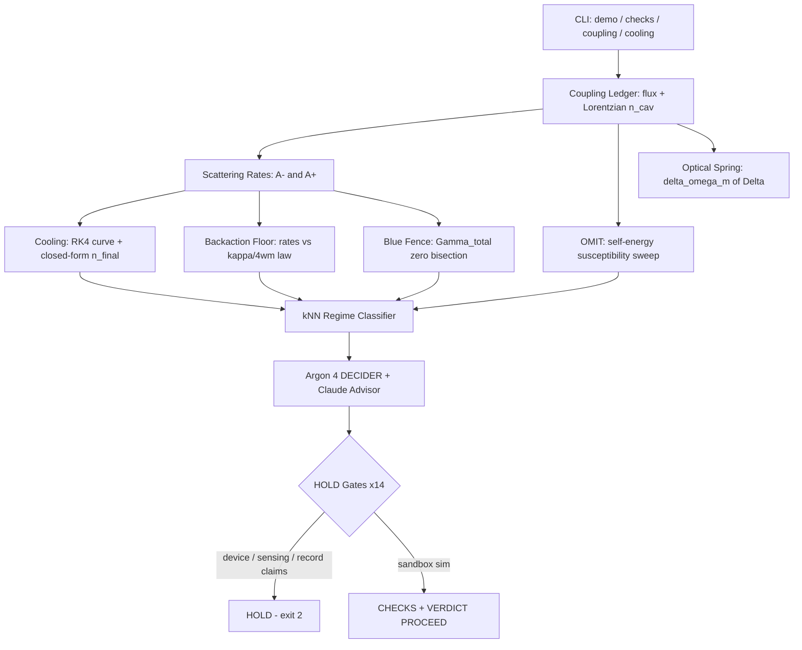
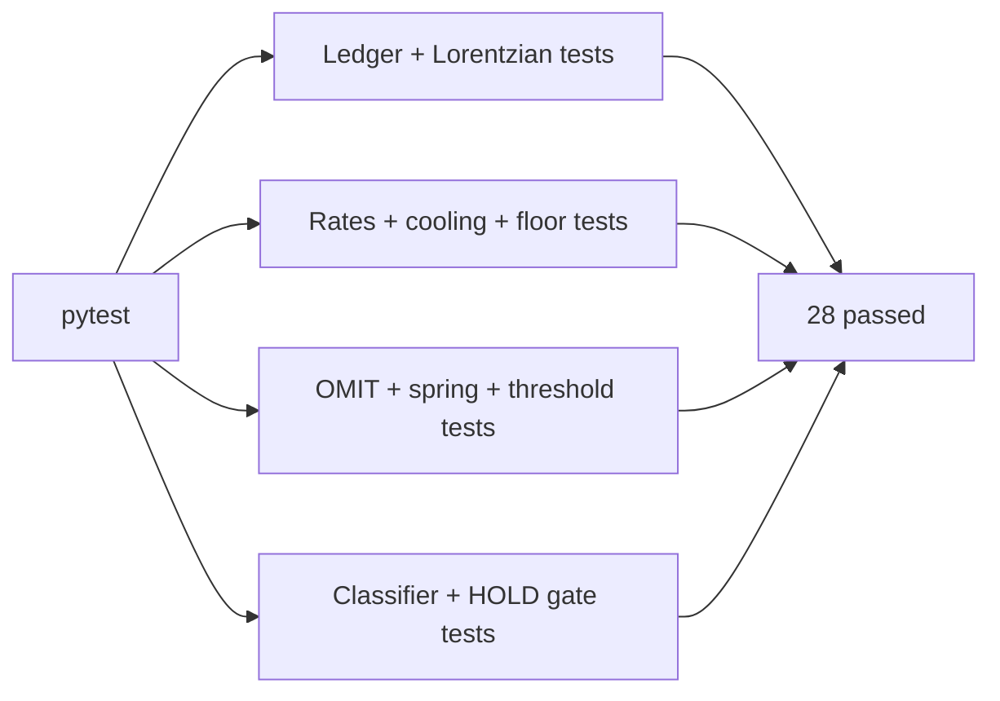
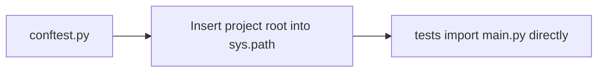
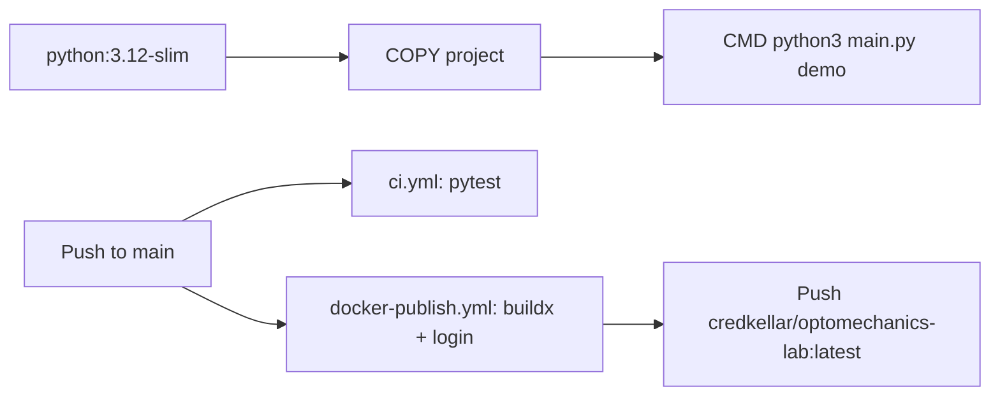

# Optomechanics-Lab 🔊⚛️

**Cavity Optomechanics Lab — Sideband Cooling, OMIT & the Optical Spring** — by Darion Kellar

Optomechanics-Lab is an **educational cavity-optomechanics lab** in ONE pure-Python file: the linearized theory of one driven optical cavity coupled to one mechanical oscillator, computed from scratch and graded against its own closed forms at every step. A single cavity Lorentzian produces the intracavity photon number; from it flow the enhanced coupling `g = g0·√n_cav`, the cooperativity ledger, the anti-Stokes/Stokes scattering rates, and everything else — red-sideband cooling to a final occupancy of **0.032 phonons** for the resolved-sideband device (κ/ωm = 0.2), the same device class stuck at **2.10 phonons** when κ/ωm = 5 because its quantum backaction floor `(κ/4ωm)² = 1.5625` sits above one phonon, an OMIT transparency window of **0.999704** burned into an exactly-zero cavity notch, an optical spring that softens by **−1,683.9 Hz** on the red sideband and stiffens by exactly the opposite on the blue, and a blue-detuned instability threshold bisected at cooperativity **C = 1.0025**. A from-scratch kNN classifier labels regimes from the lab's own policy.

Honest scope, stated up front: every parameter is a **labelled teaching number** (ωm/2π = 1 MHz, γm/2π = 10 Hz, n_th = 200 ≈ a 1 MHz mode near 10 mK, g0/2π = 200 Hz, 1 µW at 1064 nm). No cavity was built, no mirror was cooled, no displacement was sensed. A computed occupancy is a property of these equations at these inputs — not a cooling record, not a device specification, not a sensing claim. Every real-device / deployment / vendor claim sits behind a permanent HOLD gate (14 total). 🔒

[](https://github.com/kimanicollier44-cmyk/Optomechanics-Lab/actions/workflows/ci.yml)
[](https://github.com/kimanicollier44-cmyk/Optomechanics-Lab/actions/workflows/docker-publish.yml)

> ℹ️ These are the **live** workflow badges for this repo. They activate as soon as the `ci.yml` and `docker-publish.yml` files from the paste pack are pasted into `.github/workflows/` — until then they have nothing to report yet.

## 🧰 Tech Stack Badges & Full Architecture Tech Stack

### 💻 Core Programming Languages & Core Systems


- 🐍 Python 3.12, pure standard library (`math`, `cmath`, `hashlib`, `json`, `sys`) — zero dependencies, zero network, deterministic (double-run byte-identical)
- 🔦 Coupling core from scratch: photon flux `P/(ħω_L)`, the cavity Lorentzian `n_cav = Φ·κ_ex / ((κ/2)² + Δ²)` with the lab convention κ_ex = κ/2, enhanced coupling `g = g0·√n_cav`, cooperativity `C = 4g²/(κγm)` and thermal cooperativity `C_th = C/(2n_th + 1)` — one definition each, used everywhere, asserted in CHECKS
- ❄️ Cooling core: scattering rates `A∓ = g²κ / ((κ/2)² + (Δ ± ωm)²)` exactly as stated, optical damping `Γ_opt = A− − A+`, the backaction floor `A+/(A− − A+)` graded against `(κ/4ωm)²`, and the rate equation integrated with written-out RK4 and graded against its own exact transient
- 🪟 OMIT core: the probe susceptibility with the optomechanical self-energy `Σ(ε) = g²/(γm/2 − iε)` in the input–output relation — peak, bare dip, and window width are all read off the computed curve, never quoted
- 🧠 TinyML kNN regime classifier (from scratch, stdlib, distance-weighted): resolved-sideband-cooling / unresolved-sideband / weak-coupling / strong-coupling / blue-detuned-unstable from (κ/ωm, C, sign of Γ_total), labels from the lab's own policy
- 🪑 Council seats: Gemini Argon 4 DECIDER (names-only, tighten-only) + Muse advisor (never overrides HOLD) + Google Flow plan-only (rendered = False, live = 0)

### ⛓️ Web3 & Infrastructure

- 🚫 **Not applicable — honestly.** No blockchain, no Web3, no tokens: the "infrastructure" in this lab is one offline file holding a cavity susceptibility, two scattering rates, and a rate equation. Gravitational-wave and sensing deployment are permanent HOLD gates, not features. No fake badges here.

### ⚙️ Platform Support & Hardware Architecture


- 🖥️ Pure Python — runs anywhere Python 3.12+ runs (Linux, macOS, Windows), plus the `python:3.12-slim` Docker image
- 🔒 No hardware is controlled, ever: real cavities, lasers, cryostats, and interferometers are permanent HOLD gates (see the gate table below)

### ⚡ Low-Level Infrastructure & Performance

- 🚫 **No low-level code — honestly.** No C, no C++, no GPU, no compiled extensions: this is one interpreted Python file on purpose, so every rate can be read, checked, and diffed. Performance here means honest algorithms — a 1,201-point probe sweep, a 1,000-step RK4 cooling integration, and a 90-step bisection for the instability threshold — all deterministic and byte-identical between runs.

### 🛠️ DevOps & Build Tools


- 🐳 Docker (`python:3.12-slim`), GitHub Actions CI + Docker Publish (delivered in the paste pack)
- 🎯 Target image: `credkellar/optomechanics-lab:latest`
- 🧪 Tests: `pytest` (28 tests) + the built-in CHECKS suite (52 checks) in `main.py`

### ☁️ Cloud Providers

- 🚫 **None — honestly.** No cloud provider is used or needed: the lab runs fully offline on your own machine or in a local Docker container. Docker Hub appears only as the registry the publish workflow pushes the image to.

## What this does?

1. 🔦 **The coupling ledger — one Lorentzian under everything** — the 1 µW, 1064 nm drive is a flux of **5.3563 × 10¹² photons/s**; the cavity Lorentzian (κ_ex = κ/2) turns it into n_cav = **8,524,816** on resonance and **84,404** on either sideband, so `g = g0·√n_cav` reaches g/2π = **58,104.8 Hz** at the working point (g/κ = 0.2905, C = **6,752.3**, C_th = 16.84). Every later number is downstream of this table.
2. ❄️ **Scattering rates, stated exactly** — `A∓ = g²κ / ((κ/2)² + (Δ ± ωm)²)`. On the red sideband the anti-Stokes rate is exactly `4g²/κ` (asserted in CHECKS) and the optical damping is Γ_opt/2π = **67,354.9 Hz**; on the blue sideband the same formula flips sign — the heating/cooling asymmetry is the whole subject in one line.
3. 🎯 **The backaction floor, graded two ways** — from the rates, `n_min = A+/(A− − A+) = 0.002500`; from the textbook law, `(κ/4ωm)² = 0.002500`. They agree to the printed digits for the resolved device — and for the κ/ωm = 5 device both give **1.5625**, above one phonon before any thermal load is added.
4. 🧊 **Sideband cooling, integrated and closed-form** — the rate equation `dn/dt = −(γm + Γ_opt)n + γm·n_th + A+` is RK4-integrated from n_th = 200 (200 → 24.1229 → 2.9345 → 0.3818 → 0.0373 at 5/10/15/25 µs) and graded against its exact transient; the closed-form steady state is **n_final = 0.032189** — ground state reached, with the gap above the 0.0025 floor priced exactly: it is the thermal bath leaking in through γm.
5. 🚧 **The unresolved fence** — same drive, same oscillator, κ/2π = 5 MHz: Γ_opt collapses to 2π × 3,670.9 Hz and **n_final = 2.1016**. No drive power fixes this in the model — the floor is a ratio of rates, and the sweep (step 8) shows it growing as κ². The fence is printed at full size, not rounded away.
6. 🪟 **OMIT — a window burned into a notch** — the probe response `t(ε) = 1 − κ_ex / (κ/2 − iε + g²/(γm/2 − iε))` is computed on a 1,201-point sweep: the bare cavity dip is **exactly 0** at line centre, the control burns a transparency peak of **0.999704** into it — matching `(C/(1+C))²` to 1e-9 — with FWHM **53,315 Hz** against the γm + Γ_opt estimate of 67,365 Hz (ratio 0.791, the full-curve power-half-max vs the Lorentzian estimate; the notch itself is 400,000 Hz wide).
7. 🎚️ **The optical spring — sign flip asserted** — `δωm(Δ)` from the same self-energy: **−1,683.9 Hz** (softening) at Δ = −ωm, **+1,683.9 Hz** (stiffening) at Δ = +ωm, exactly 0 on resonance, and exactly odd in Δ at every tabulated point — including the honest surprise inside |Δ| < ωm, where the two sideband terms compete and the curve crosses zero again (+4,251.8 Hz at Δ = −ωm/2).
8. 📈 **The regime sweep** — κ/ωm from 0.05 to 10 at fixed drive: the floor climbs 0.00015625 → 6.25 (as κ², as advertised) and n_final follows it 0.0295 → **11.4612**, while Γ_opt falls two orders of magnitude. One table that shows exactly where ground-state cooling stops being available.
9. ⚠️ **The blue-detuned fence** — detune to Δ = +ωm and bisect the drive power where Γ_total = γm + Γ_opt crosses zero: **P = 0.148 nW**, at cooperativity **C = 1.0025** — the threshold lands where the definition says it should. At the 1 µW headline drive Γ_total = −423,140.5 /s: the linear model says self-oscillation, and the lab fences that as a sign change in a rate equation, not a phonon-laser product (a HOLD gate).
10. 🏷️ **Regime classifier + seats + checks** — a from-scratch distance-weighted kNN labels the computed scenarios (resolved drive → resolved-sideband-cooling; κ/ωm = 5 → unresolved-sideband; 0.1 nW → weak-coupling; 100 µW → strong-coupling; blue detuning → blue-detuned-unstable), with Argon 4 DECIDER (sha256 trace), Muse advisor, Google Flow plan-only, and a built-in CHECKS suite (52 checks).

## 🗺️ How it works — diagram per script

### `main.py` — the whole lab



### `tests/test_main.py` — verification



### `conftest.py` — test path setup



### `Dockerfile` + CI flow — container & publish



## Why is this cool?

1. 🔦 One Lorentzian runs the entire lab — photon flux in, and coupling, rates, cooling, OMIT, spring, and instability all fall out of the same `n_cav`. Change one line and the whole physics moves consistently.
2. 🎯 The quantum limit is *derived*, not quoted: the rate ratio `A+/(A− − A+)` and the law `(κ/4ωm)²` are computed independently and agree to the printed digits — in both the device that cools and the one that can't.
3. 🧊 Ground-state cooling with the receipt: n goes 200 → 0.032, and the lab prices the gap above the 0.0025 floor exactly — it's the thermal bath leaking through γm, in numbers.
4. 🚧 The failure case is a first-class result: the unresolved device's floor (1.5625) is above one phonon, so its n_final = 2.10 is a theorem about ratios, not a tuning problem. The sweep shows the floor growing as κ².
5. 🪟 OMIT's peak is an identity, not a fit: the computed window height matches `(C/(1+C))²` to 1e-9, and the bare notch it is burned into is exactly zero at line centre.
6. 🎚️ The optical spring's sign flip is *exact*: antisymmetry δωm(−Δ) = −δωm(Δ) holds to machine precision, and the table even keeps the counterintuitive zero-crossing inside |Δ| < ωm that brochure versions omit.
7. ⚠️ The instability threshold lands on the definition: bisect Γ_total = 0 and you get C = 1.0025 — the cooperativity stops being an abstract ratio and becomes a measured fence post.
8. 🧮 The integrator is graded against its own equation: RK4 vs the exact transient of the rate equation, so "the curve" is never just a plot shape.
9. 🏷️ The classifier's features are all measured by the lab itself — κ/ωm, C, and the *sign of a computed damping rate* — so the blue-detuned verdict is earned by the physics, not assigned by the prose.
10. 🎯 Deterministic end to end: run it twice, get byte-identical output — an optomechanics bench you can diff.

## What problems this solves?

1. ❌ **Problem:** "Sideband cooling reaches the ground state" is usually asserted with a cartoon. ✅ **Solution:** The rates, the floor, and the final occupancy are computed and cross-graded — 0.032 phonons, with the thermal-leak gap above the floor priced in the same table.
2. ❌ **Problem:** The resolved-sideband condition is quoted as a vibe ("κ small"). ✅ **Solution:** The sweep makes it arithmetic: the floor is `(κ/4ωm)²`, it crosses one phonon between κ/ωm = 2 and 5, and n_final follows it from 0.0295 to 11.4612.
3. ❌ **Problem:** Cooperativity is defined differently in every paper and slide deck. ✅ **Solution:** One definition, stated once (`C = 4g²/(κγm)`, `C_th = C/(2n_th + 1)`), used in the ledger, the OMIT peak, the classifier, and the instability threshold — where it pays off at C = 1.0025.
4. ❌ **Problem:** OMIT plots are shown without the bare-cavity reference. ✅ **Solution:** Both curves are computed on the same sweep: the notch is exactly zero at centre, so the 0.999704 window height is measured against a real zero.
5. ❌ **Problem:** Window widths get quoted from the γm(1 + C) estimate as if exact. ✅ **Solution:** The FWHM is read off the computed curve by half-max crossings and printed next to the estimate with its ratio (0.791) — the difference is reported, not hidden.
6. ❌ **Problem:** Optical-spring sign rules are memorised as slogans that fail off the sidebands. ✅ **Solution:** The full δωm(Δ) curve is computed and tabulated, antisymmetry is asserted, and the extra zero-crossing inside |Δ| < ωm is printed where it occurs.
7. ❌ **Problem:** "Blue detuning is unstable" rarely comes with the threshold. ✅ **Solution:** The threshold is bisected in drive power (0.148 nW) and expressed in cooperativity (C ≈ 1), with Γ_total printed on both sides of the crossing.
8. ❌ **Problem:** Cooling curves in teaching material are exponentials drawn by hand. ✅ **Solution:** The curve is an RK4 integration of the actual rate equation, graded against the equation's exact transient solution.
9. ❌ **Problem:** Simulation tools quietly imply a sensor or a record is next. ✅ **Solution:** 14 named HOLD gates return exit code 2 for every device-control, fabrication, sensing-deployment, metrology, and cooling-record claim, forever.
10. ❌ **Problem:** Labelled teaching parameters get laundered into "specifications". ✅ **Solution:** Every parameter is printed as labelled wherever it appears, the honest-scope paragraph leads the README and the demo, and `vendor_hardware_specification_claim` is a permanent HOLD gate.

## How to install this?

1. 📋 Clone or download this project folder.
2. 🐍 Make sure Python 3.12+ is installed: `python3 --version`
3. ▶️ Run the full demo + checks (no arguments needed):

```bash
python3 main.py
```

4. 🧪 Run the test suite:

```bash
pip install pytest
python3 -m pytest -q
```

5. 🎛️ Try the other commands:

```bash
python3 main.py checks    # 52 built-in checks
python3 main.py coupling  # photon flux, n_cav, g, cooperativity ledger (JSON)
python3 main.py cooling   # resolved vs unresolved: rates, floors, RK4 curves (JSON)
python3 main.py omit      # probe sweep: bare dip, window peak + FWHM (JSON)
python3 main.py spring    # optical spring shift vs detuning (JSON)
python3 main.py regimes   # kappa sweep + blue-detuned threshold (JSON)
python3 main.py classify  # kNN regime classifier report
python3 main.py brains    # Argon 4 + Muse + Flow seats
python3 main.py holds     # list all 14 HOLD gates
python3 main.py hold-demo # exits 2 - gated actions stay HOLD
```

6. 🐳 Or run it in Docker:

```bash
docker build -t credkellar/optomechanics-lab:latest .
docker run --rm credkellar/optomechanics-lab:latest
```

## Requirements

- 🐍 Python 3.12 or newer
- 📦 Dependencies: **none** (standard library only)
- 🌐 Network: **none** — fully offline
- 🧪 For tests only: `pytest`
- 🐳 Optional: Docker

## FULL project structure tree

```text
optomechanics-lab/
├── main.py                  # the whole lab: coupling ledger, scattering rates, cooling, OMIT, optical spring, blue-detuned fence, classifier, seats, HOLD gates
├── conftest.py              # puts the project root on sys.path for tests
├── tests/
│   └── test_main.py         # 28 pytest tests: ledger, rates, cooling, OMIT, spring, threshold, classifier, gates, determinism
├── assets/
│   └── cover.png            # README cover image (2736 x 912)
├── Dockerfile               # python:3.12-slim, runs the demo
├── .gitignore               # __pycache__/, .pytest_cache/, *.pyc
└── README.md                # this file
```

> 📦 Delivered separately as paste packs (not in this tree): `.github/workflows/ci.yml` + `docker-publish.yml`, and the Docker Hub pack (100-char description, 350-char About, overview, categories).

## 🔒 HOLD gates — all 14, permanent

| # | Gate | What stays held |
|---|------|-----------------|
| 1 | `real_cavity_device_control` | No control of a real cavity, laser, or mechanical device from this lab |
| 2 | `device_fabrication_claim` | No fabrication guidance or claim the labelled device can be built as modelled |
| 3 | `gravitational_wave_detection_claim` | No gravitational-wave detection claim; a teaching susceptibility is not an interferometer |
| 4 | `quantum_sensing_deployment_claim` | No deploying this model as a quantum sensor or sensing product |
| 5 | `force_sensing_product_claim` | No force-sensing product claim from a rate-equation model |
| 6 | `displacement_metrology_certification` | No certifying displacement sensitivity, calibration, or metrology traceability |
| 7 | `vendor_hardware_specification_claim` | The labelled parameters are not any vendor's hardware specification |
| 8 | `ground_state_cooling_record_claim` | A computed occupancy is not a cooling record, benchmark, or first demonstration |
| 9 | `phonon_laser_product_claim` | Blue-detuned self-oscillation in a model is not a phonon-laser product or device claim |
| 10 | `sql_beating_product_claim` | No claim of beating the standard quantum limit in any real instrument |
| 11 | `cryogenic_operation_direction` | No directing cryogenic, vacuum, or laser-safety operations from a simulation |
| 12 | `laser_safety_clearance_claim` | No laser-safety clearance, exposure assessment, or interlock decision |
| 13 | `commercial_sensor_claim` | No commercial sensor, LIDAR, or navigation claim from this lab |
| 14 | `quantum_advantage_claim` | No quantum-advantage claim; linearized classical-rate physics, computed honestly |

🧑‍⚖️ **Council seats:** Gemini Argon 4 Extended Thinking — DECIDER (names-only, tighten-only, MAP → MODEL → STRESS → DECIDE, sha256 trace, `can_override_hold = False`) · Muse — advisor (`can_override_hold = False`) · Google Flow — plan-only (`rendered = False`, `live = 0`).

✅ **Verification:** pytest **28 passed** (project + clean copy) · built-in CHECKS **52/52** · double-run output **byte-identical** · `hold-demo` exits **2** · `main.py` **821 lines**, pure stdlib, zero network.

## 🧒 5th-grade English section

Imagine a tiny mirror hanging on a spring, facing another mirror. Light bounces back and forth between them, and every bounce gives the little mirror a tiny push. 🔦

- If you shine the light with exactly the right colour — a bit more "red" than the light that fits best between the mirrors — each push steals a tiny bit of the mirror's jiggling. Steal enough jiggles and the mirror gets **calmer and calmer**, almost perfectly still. This lab counts the jiggles: from 200 down to about **0.03** — almost none left! ❄️
- But it only works if the light leaks out of the mirrors at the right speed. If the mirrors leak too slowly, the light itself keeps bumping the mirror, and it can never get below about **2 jiggles** — the lab shows that wall with numbers, so nobody can pretend it isn't there. 🚧
- While the calming light is on, a second, super-weak light beam can suddenly slip straight through a spot where it used to be blocked — like a window opening in a wall for one exact colour. The lab draws that window: it lets through **99.97%** of the weak beam. 🪟
- The light also works like an invisible spring: shine it a little red and the mirror's spring gets **softer**; shine it a little blue and it gets **stiffer** — by exactly the same amount, which the lab checks. 🎚️
- Shine it blue with too much power, though, and instead of calming the mirror, the light starts pushing it harder and harder. The lab finds the exact power where that tipping point happens — and then refuses to call it a product, because it's just math on a computer. ⚠️
- This project is a **pretend lab on a computer**. It does not build a real mirror machine or measure anything real. It helps you learn how light can cool, push, and calm tiny things — with every number checked. 💻

---

MIT © 2026 Darion Kellar · Optomechanics-Lab — educational simulation only 🔊
